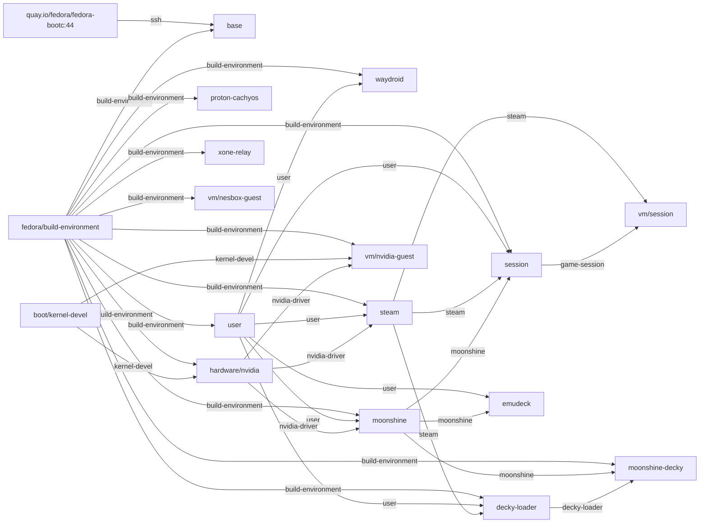

# steam-microvm-nvidia capability graph

GENERATED FILE, do not edit.

An arrow points from a provider to what needs it, dotted for `after`,
which orders the build without requiring anything. Layers build left to
right.

## Capabilities

| Name | Kind | Provided by | Required by | After |
|---|---|---|---|---|
| `bootc` | capability | `base` |  |  |
| `bootupctl` | capability | `base` |  |  |
| `build-environment` | capability | `fedora/build-environment` | `base`, `user`, `proton-cachyos`, `waydroid`, `hardware/nvidia`, `steam`, `moonshine`, `session`, `decky-loader`, `moonshine-decky`, `vm/nvidia-guest`, `xone-relay`, `vm/nesbox-guest` |  |
| `crun` | capability | `base` |  |  |
| `decky-loader` | file | `decky-loader` | `moonshine-decky` |  |
| `game-session` | file | `session` | `vm/session` |  |
| `initramfs-generation` | capability | `base` |  |  |
| `kernel` | capability |  |  | `boot/kernel-devel` |
| `kernel-devel` | file, build only | `boot/kernel-devel` | `hardware/nvidia`, `vm/nvidia-guest` |  |
| `luks-initramfs` | capability | `base` |  |  |
| `moonshine` | file | `moonshine` | `session`, `moonshine-decky`, `emudeck` |  |
| `nvidia-driver` | file | `hardware/nvidia` | `steam`, `moonshine`, `vm/nvidia-guest` |  |
| `nvidia-kmod` | file | `hardware/nvidia` |  |  |
| `nvidia-repo` | file | `hardware/nvidia` |  |  |
| `podman` | capability | `base` |  |  |
| `rechunking` | capability | `base` |  |  |
| `secureboot-key` | capability |  |  | `hardware/nvidia` |
| `selinux-policy` | capability | `base` |  |  |
| `ssh` | capability | `base` | `base` |  |
| `steam` | file | `steam` | `session`, `decky-loader`, `vm/session` |  |
| `user` | file | `user` | `waydroid`, `steam`, `moonshine`, `session`, `decky-loader`, `emudeck` |  |
